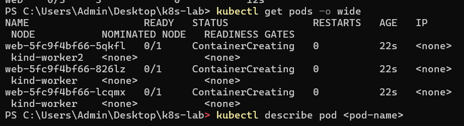
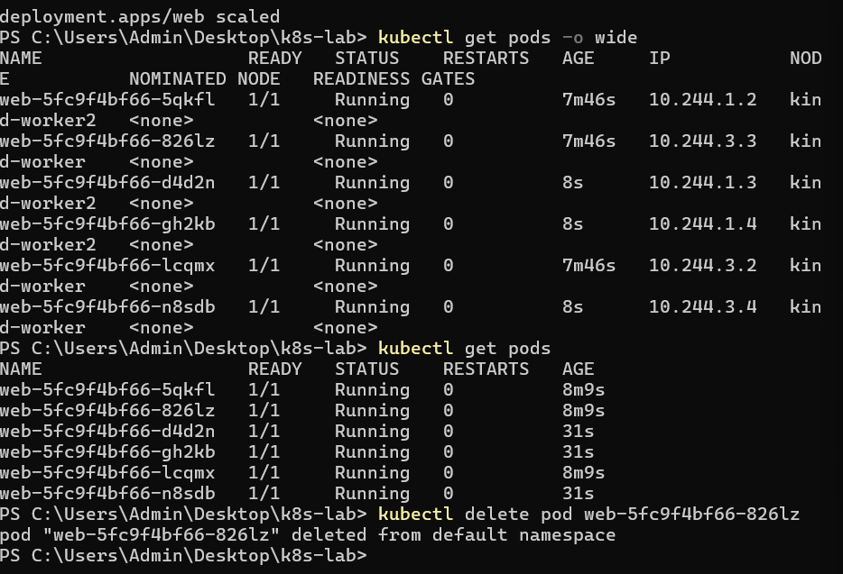
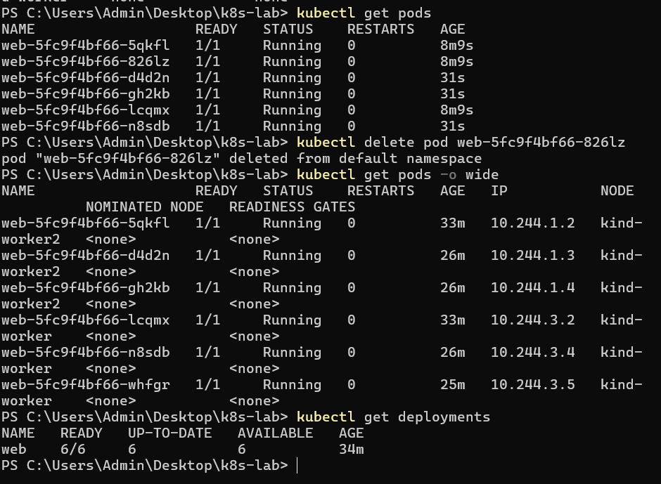

# Kubernetes Lab on Windows – NGINX Deployment, Scaling & Self-Healing

## 1. Project Overview

This project demonstrates the implementation of a local three-node Kubernetes cluster on Windows using Docker Desktop and kind (Kubernetes IN Docker).

The lab focuses on deploying an NGINX web application, managing multiple replicas, observing Pod distribution across worker nodes, scaling the application, and testing Kubernetes self-healing capabilities.

The cluster consists of one control-plane node and two worker nodes, with all Kubernetes nodes running as Docker containers.

## 2. Objectives

- Set up a local Kubernetes environment on Windows.
- Create a three-node Kubernetes cluster using kind.
- Understand the role of control-plane and worker nodes.
- Deploy an NGINX application using a Kubernetes Deployment.
- Monitor Pod status and distribution across worker nodes.
- Scale the application from three replicas to six replicas.
- Test Kubernetes self-healing by manually deleting a Pod.
- Understand how Kubernetes maintains the desired application state.

## 3. Technologies Used

| Technology | Purpose |
|---|---|
| Windows 10/11 | Host operating system |
| WSL 2 | Linux environment for Docker Desktop |
| Docker Desktop | Runs Kubernetes node containers |
| Kubernetes | Container orchestration |
| kind | Creates a local Kubernetes cluster |
| kubectl | Communicates with the Kubernetes cluster |
| NGINX | Web server application |
| YAML | Cluster configuration |

## 4. System Architecture

The lab uses a three-node Kubernetes architecture.

```text
                 Windows Laptop
                       |
                   PowerShell
                       |
                 Docker Desktop
                       |
                   KIND Cluster
                       |
          +------------+------------+
          |                         |
     Control Plane             Worker Nodes
          |                         |
  kind-control-plane       +---------+---------+
                           |                   |
                      kind-worker        kind-worker2
                           |                   |
                       NGINX Pods          NGINX Pods
```

**Control Plane:** Manages the cluster, maintains its state, and coordinates scheduling.

**Worker Nodes:** Execute application workloads by running Kubernetes Pods.

**Pods:** Smallest deployable units in Kubernetes that contain application containers.

## 5. Implementation – Six Lab Stages

### Stage 1: Installation of Required Tools

The following tools were installed and configured:

- WSL 2
- Docker Desktop
- kubectl
- kind

Installation commands:

```powershell
wsl --install
winget install -e --id Kubernetes.kubectl
winget install -e --id Kubernetes.kind
```

Docker Desktop was configured to use the WSL 2 backend.

### Stage 2: Verification of Tools

The installed tools were verified using:

```powershell
docker version
docker run hello-world
kubectl version --client
kind version
```

These commands verified Docker functionality, container execution, kubectl installation, and kind installation.

### Stage 3: Creation of Kubernetes Cluster Configuration

A configuration file named `kind-config.yaml` was created to define the cluster structure.

**Configuration:**

```yaml
kind: Cluster
apiVersion: kind.x-k8s.io/v1alpha4
nodes:
  - role: control-plane
  - role: worker
  - role: worker
```

This configuration specifies:
- One control-plane node.
- Two worker nodes.

### Stage 4: Creation and Verification of the Cluster

The Kubernetes cluster was created using:

```powershell
kind create cluster --config kind-config.yaml
```

Cluster connectivity was checked using:

```powershell
kubectl cluster-info --context kind-kind
```

Node status was verified using:

```powershell
kubectl get nodes
```

Additional verification:

```powershell
docker ps
kubectl get pods -n kube-system -o wide
```

The cluster contains three nodes:

| Node | Role |
|---|---|
| kind-control-plane | Control Plane |
| kind-worker | Worker |
| kind-worker2 | Worker |

All three nodes successfully reached the Ready state.

### Stage 5: Deployment of NGINX Application

An NGINX Deployment named `web` was created with three replicas.

```powershell
kubectl create deployment web --image=nginx --replicas=3
```

Deployment status was checked using:

```powershell
kubectl get deployments
```

Pod information was retrieved using:

```powershell
kubectl get pods -o wide
```

The command displays:
- Pod names
- Readiness status
- Running status
- Restart count
- Pod IP addresses
- Worker-node placement

Individual Pod details can be inspected using:

```powershell
kubectl describe pod ACTUAL_POD_NAME
```

Replace `ACTUAL_POD_NAME` with an actual Pod name from the command output.

**Observation:** The three NGINX Pods were scheduled across the two worker nodes. The initial screenshot captures them in the `ContainerCreating` state during startup.

### Stage 6: Scaling and Self-Healing

#### A. Scaling from 3 to 6 Replicas

The Deployment was scaled to six replicas using:

```powershell
kubectl scale deployment web --replicas=6
```

The Deployment and Pods were verified using:

```powershell
kubectl get deployments
kubectl get pods -o wide
```

**Observation:** All six NGINX Pods reached the `1/1 Running` state and were distributed across both worker nodes.

#### B. Testing Self-Healing

To test Kubernetes self-healing, one running Pod was manually deleted.

Command used:

```powershell
kubectl delete pod web-5fc9f4bf66-826lz
```

Kubernetes confirmed that the selected Pod was deleted successfully.

The Deployment controller automatically created a replacement Pod to maintain the desired replica count.

Verification commands:

```powershell
kubectl get pods -o wide
kubectl get deployments
```

**Actual Result:**

The replacement Pod created by Kubernetes was:

```text
web-5fc9f4bf66-whfgr
```

The final Deployment status was:

| Deployment | READY | UP-TO-DATE | AVAILABLE |
|---|---:|---:|---:|
| web | 6/6 | 6 | 6 |

This confirms that Kubernetes successfully restored the desired six replicas after Pod deletion.

## 6. Results and Observations

| Experiment | Result |
|---|---|
| Kubernetes cluster creation | Successful |
| Control-plane node | Ready |
| Worker nodes | Two Ready nodes |
| Initial NGINX deployment | 3 replicas created |
| Initial Pod status | ContainerCreating during startup |
| Scaling operation | Increased from 3 to 6 |
| Six-replica verification | All 6 Pods Running |
| Pod scheduling | Distributed across two workers |
| Manual Pod deletion | Successfully deleted |
| Self-healing | Replacement Pod created automatically |
| Final deployment status | 6/6 READY, 6 UP-TO-DATE, 6 AVAILABLE |

### Pod Distribution Observation

During the six-replica experiment, the observed distribution was:

| Worker Node | Number of Pods |
|---|---:|
| kind-worker | 3 |
| kind-worker2 | 3 |
| **Total** | **6** |

The distribution represents the observed execution. Kubernetes scheduling can produce different placements in another run.

## 7. Screenshots and Experimental Evidence

The following screenshots document the actual execution of the Kubernetes lab.

### 7.1 Initial Pod Creation

The screenshot captures the initial state where the three NGINX Pods were in `ContainerCreating`.

This is a temporary startup state while the containers are being initialized.



### 7.2 Scaling and Pod Distribution

The screenshot demonstrates:

- Scaling the Deployment from three to six replicas.
- Six NGINX Pods reaching `1/1 Running`.
- Pod distribution across two worker nodes.
- Successful manual deletion of one Pod.



### 7.3 Self-Healing Verification

After deleting one Pod, Kubernetes automatically created a replacement Pod named `web-5fc9f4bf66-whfgr`.

The screenshot verifies that all six Pods returned to the Running state and the Deployment reached `6/6` ready replicas.



## 8. Key Kubernetes Concepts Learned

| Concept | Understanding |
|---|---|
| Cluster | Collection of nodes managed by Kubernetes |
| Control Plane | Manages and coordinates the cluster |
| Worker Node | Runs application workloads |
| Pod | Smallest deployable unit in Kubernetes |
| Deployment | Manages application replicas |
| Scheduler | Assigns Pods to suitable nodes |
| Scaling | Changes the number of application replicas |
| Self-Healing | Restores the desired state when a managed Pod is deleted |

## 9. Troubleshooting

| Problem | Solution |
|---|---|
| Access denied while creating a folder | Use Desktop or another writable directory instead of System32 |
| YAML parsing error | Check line breaks and indentation; remove copied line numbers |
| Docker connection error | Start Docker Desktop and wait until the engine is running |
| kubectl or kind not recognized | Reopen PowerShell after installation |
| Pod shows ContainerCreating | Wait for container initialization and check again |
| ImagePullBackOff | Check internet connectivity and inspect Pod Events |
| PowerShell angle-bracket error | Replace placeholders with actual names without angle brackets |

## 10. Conclusion

This lab successfully demonstrates the fundamental workflow of Kubernetes container orchestration on a Windows environment.

A three-node Kubernetes cluster was created using kind, and an NGINX application was deployed with three replicas. The application was subsequently scaled to six replicas, and Pod scheduling across worker nodes was observed.

A manual Pod deletion experiment was also performed to study Kubernetes self-healing behavior. Kubernetes automatically created a replacement Pod and restored the Deployment to six available replicas.

Through this implementation, the lab provides practical understanding of cluster architecture, container orchestration, Deployment management, replica scaling, Pod scheduling, and automated workload recovery.
